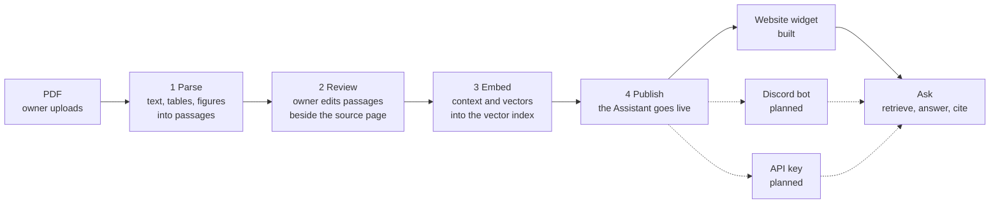
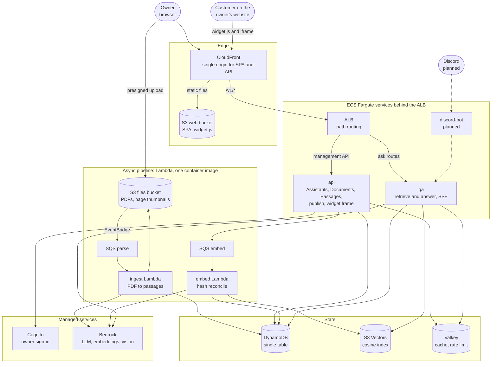
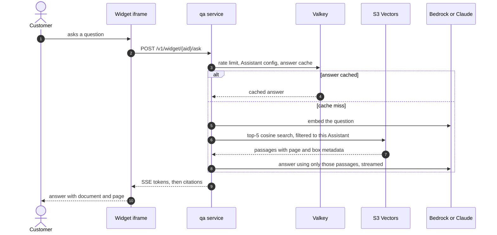

# RAGcat

**Turn PDFs into a customer-support assistant whose every answer cites its source page.**

RAGcat is a retrieval-augmented generation (RAG) system built for the CAB432 (QUT) cloud computing assessment. A small-business owner uploads PDFs, reviews the extracted passages next to the original pages, embeds them, and publishes an Assistant. Customers then ask questions through a **website chat widget** (built) or a **Discord bot** (planned), and each answer names the document and page it came from.

```
PDF  →  parse  →  review  →  embed  →  publish  →  website widget / Discord bot  →  cited answers
```

What sets it apart from generic chat-over-documents tools: the owner reviews and edits exactly what the Assistant will read (human-reviewed passages), and every answer points back to its exact source location.

| Channel | Status |
|---|---|
| Website widget (`<script>` tag, origin allowlist, rate limited) | Built |
| Discord bot (@mention in a bound channel) | Planned (P2). Design in [`docs/api-design.md`](docs/api-design.md) §8; hidden in the UI |
| API keys for external HTTP clients | Planned (P1) |

## Architecture

### End-to-end pipeline



1. **Parse.** The browser uploads the PDF straight to S3 with a presigned POST (up to 50 MB and 300 pages). An S3 event reaches the `ingest` Lambda through SQS. It uses PyMuPDF to extract text blocks and keeps each table whole as Markdown. It reads two-column pages one column at a time and strips headers, footers and page numbers. Informative figures are described by a vision model. The text is cut into passages, and page thumbnails are rendered for the Review screen.
2. **Review.** The owner sees every passage beside its source page and can edit, merge, split, add, remove or restore it. Quality warnings flag suspicious passages. Edits use optimistic locking (`If-Match`), so two tabs can't overwrite each other.
3. **Embed** (the **Publish changes** button). The `embed` Lambda reconciles passages with the vector index by content hash.
   - It only embeds what changed, so retries are idempotent, edits are never lost, and switching the embedding model re-embeds everything automatically.
   - With contextual retrieval on (default), an LLM first writes a short context and entity list for each passage from its section. The vector is computed from that context plus the passage text.
   - Vectors go into S3 Vectors (cosine). Citation data (text, page, paragraph, boxes) is stored in the vector metadata, so answering never needs a database read for citations.
4. **Publish.** The first publish turns the Assistant on for customers. Later edits go live as soon as they are embedded. Customers only ever see embedded passages. Before an Assistant is live, **Test** publishes changed documents first. After that, the owner can preview unpublished edits privately, and Publish reuses the vectors the preview prepared.
5. **Ask.** The `qa` service embeds the question and retrieves the top 5 passages for that Assistant. It then asks the LLM to answer using only those passages and turns `[n]` markers into at most 3 citations (document, page, paragraph, boxes). If the documents don't cover the question, it declines and gives the owner's fallback contact.

### AWS deployment



| Runtime | Role | Scaling |
|---|---|---|
| `api` (ECS Fargate) | Assistant, Document and Passage CRUD, publish switch, widget frame | Target tracking on ALB requests per target, 1–2 tasks |
| `qa` (ECS Fargate) | Retrieval and generation, shared by web, widget and HTTP clients (and Discord later) | Same policy, 1–4 tasks. It is I/O bound, so CPU isn't the metric |
| `ingest` (Lambda) | Parse PDF, describe figures, render thumbnails, cut passages | SQS-triggered, max concurrency 5 |
| `embed` (Lambda, same image) | Reconcile passages and vectors | SQS-triggered, max concurrency 2 (Bedrock throttling) |
| `discord-bot` (ECS Fargate) | Discord Gateway relay (planned) | One task |

Notes:
- Both ECS services use one `ragcat-service` image with different commands. Both Lambdas use one `ragcat-worker` image.
- In the CAB432 shared account, CloudFront can't use a private VPC origin, so the ALB is internet-facing on HTTPS and forwards only requests carrying CloudFront's secret header. Details are in [`infra/README.md`](infra/README.md).
- Page thumbnails stay private. The API returns short-lived presigned S3 URLs after checking ownership.
- Valkey holds the Assistant config (cache-aside), query-embedding and answer caches (answers are keyed by `content_version`, so a new embed invalidates them), widget rate-limit counters and owner-preview vectors.

### Answering a question



### Website widget

The owner lists their websites on the Publish page and pastes one line:

```html
<script src="https://<ragcat-domain>/widget.js" data-assistant="ast_..." async></script>
```

`widget.js` adds a launcher button and loads the chat iframe (`/v1/widget/{aid}/frame`) on first click. The frame's CSP `frame-ancestors` restricts embedding to the listed sites, and an empty list turns the widget off. Visitors need no account and ask one question at a time, limited to about 10 per minute. Widget answers carry only document name, page and paragraph. See [`docs/api-design.md`](docs/api-design.md) §7.

### Design choices

- **Hexagonal, one Python package.** Each bounded context (`curation`, `ingestion`, `indexing`, `answering`, `assistants`, `identity`) has `domain.py`, `service.py` and `adapters.py`. `domain.py` imports no cloud SDK. `apps/container.py` is the only place that picks adapters, so every AWS service has a local stand-in and providers switch with `RAGCAT_*` variables.
- **One DynamoDB table.** One aggregate maps to one partition and one transaction boundary. A Document and its passages share `DOC#{id}`, and `edit_version` is the optimistic-lock counter.
- **No event bus.** Work that crosses runtimes uses SQS. Everything else is a direct service call.
- **Models are replaceable.** The `Llm` and `Embedder` interfaces are the same for Claude, OpenAI, Bedrock and offline fakes. Indexing and Answering share one embedding adapter, and vector metadata records the embedding space so searches never mix incompatible vectors.

## Tech stack

| Layer | Local (`make backend`) | AWS |
|---|---|---|
| Web | React, Vite, TypeScript. English and Traditional Chinese | S3 behind CloudFront |
| API and QA | FastAPI (`ragcat.apps.dev`) | ECS Fargate, ALB, target-tracking auto scaling |
| Workers | Valkey queue and `make worker` | SQS and Lambda container images |
| Data | DynamoDB Local, `.data/` files | DynamoDB, S3, S3 Vectors |
| Models | Claude Haiku 5.5 for QA and context, OpenAI `text-embedding-3-small` | Bedrock: Gemma (QA, vision), Titan Text Embeddings v2 |
| Auth | `Bearer dev:<name>` | Cognito, with RAGcat's own sign-in page |
| Infra and ops | Docker Compose | Terraform, CloudWatch dashboard and alarms |

## Repository layout

```
backend/             Python 3.12+: FastAPI, PyMuPDF, boto3
  src/ragcat/
    curation/ ingestion/ indexing/ answering/ assistants/ identity/   bounded contexts
    infra/           adapters: DynamoDB, storage, queue, vectors, cache, model providers
    apps/            entry points: api, qa, worker (ingest, embed), dev, widget
  tests/
web/                 React SPA and the embeddable widget (web/src/widget)
infra/               Terraform for the AWS deployment (see infra/README.md)
scripts/             cloud audit, deploy, smoke test and load test
samples/             demo PDFs (a returns policy, and a Chinese care guide)
docs/                api-design.md and domain-design.md (written in Traditional Chinese)
```

Other documents: [`PRODUCT.md`](PRODUCT.md) (users, scope, vocabulary), [`DESIGN.md`](DESIGN.md) (visual system; values live in `web/src/theme/tokens.css`) and [`designs/`](designs/) (flow, copy, states and accessibility).

## Local development

Requires Docker, [uv](https://docs.astral.sh/uv/) and Node 22.16+.

```bash
make deps      # start DynamoDB Local (:8001) and Valkey (:6380); install backend and web packages
cp -n .env.local.example .env.local  # first run only; never overwrites an existing file
# put ANTHROPIC_API_KEY and OPENAI_API_KEY in .env.local
make backend   # :8010; api + qa. parse/embed jobs go to the Valkey queue (auto reload)
make worker    # in another terminal: consumes the queue and does parse and embed (no auto reload; restart after code changes)
make web       # http://localhost:5173, proxies /v1 and /dev to :8010
```

Open http://localhost:5173, create an Assistant, and upload a file from `samples/`: `mochi-returns-policy.pdf` (English, tables) or `mochi-care-guide-zh.pdf` (Chinese, two columns, tables). To regenerate them: `cd backend && uv run python ../samples/make_samples.py`.

`.env.local` is loaded by the backend only. Never commit it or expose it through `VITE_*` variables. If an API key is missing, the backend fails with a clear error instead of silently using fake models. The startup log shows the active QA, embedding and vision providers, never the keys. After changing keys, presets or model settings, stop and rerun `make backend`.

`make backend` needs no AWS access but calls paid model APIs. To verify the flow offline, use `make backend-offline`: QA, embedding and vision all use fakes and `.env.local` isn't loaded. Running uvicorn directly with no model preset also defaults to fakes.

Storage and queues stay local while model providers are chosen independently:

| Interface | Local (`make backend`) | AWS | Environment variables |
|---|---|---|---|
| Table | DynamoDB Local | DynamoDB | `RAGCAT_DYNAMODB_ENDPOINT`, `RAGCAT_TABLE` |
| Object store | `.data/objects` and `/dev/s3/upload` | S3 presigned POST | `RAGCAT_STORAGE=local\|s3` |
| Queue | Valkey list and `make worker` (3 retries, then `queue:<name>:dlq`). `backend-offline` uses a background thread | SQS → Lambda | `RAGCAT_QUEUE=local\|redis\|sqs`, `RAGCAT_QUEUE_URL` |
| Vector index | `.data/vectors.json` | S3 Vectors | `RAGCAT_VECTORS=local\|s3vectors` |
| QA / context | Claude Messages (`claude-haiku-5-5`) | Bedrock Converse (Gemma, the existing default) | `RAGCAT_LLM_PROVIDER=fake\|claude\|bedrock`, `RAGCAT_LLM_MODEL_ID` |
| Embedding | OpenAI `text-embedding-3-small`, 1536 dims | Bedrock Titan v2, 1024 dims | `RAGCAT_EMBED_PROVIDER=fake\|openai\|bedrock`, `RAGCAT_EMBED_MODEL_ID`, `RAGCAT_EMBED_DIMS` |
| Vision | Fake figure descriptions (not switched to Claude) | Bedrock Converse | `RAGCAT_VISION_PROVIDER=fake\|bedrock` |
| Cache | In-process dict | ElastiCache Valkey | `RAGCAT_CACHE=memory\|valkey` |
| Auth | `Bearer dev:<name>` | Cognito JWT | `RAGCAT_AUTH=dev\|cognito` |
| Contextual retrieval | On (Claude writes context from the section) | On (Bedrock LLM) | `RAGCAT_CONTEXTUAL=on\|off` |

`RAGCAT_MODELS` is a shortcut preset. `local` selects Claude, OpenAI and fake vision. `bedrock` runs all three on Bedrock. `fake` runs all three offline. Each provider variable overrides the preset. The QA `stream/complete` and embedding `embed` interfaces are unchanged, and Indexing and Answering use the same embedding adapter.

The OpenAI adapter calls `/v1/embeddings` per the [OpenAI documentation](https://developers.openai.com/api/reference/resources/embeddings/methods/create). It reorders batch vectors by response index and checks dimensions and values. The Claude adapter handles SSE, usage, context completion and mid-stream errors per the [Messages streaming docs](https://platform.claude.com/docs/en/build-with-claude/streaming). Haiku 5.5 runs with thinking off by default so the 120-token context and 400-token QA budgets aren't consumed by thinking ([model notes](https://platform.claude.com/docs/en/models/haiku-5-5/whats-new-haiku-5-5)). Other Claude models can be selected with `RAGCAT_LLM_MODEL_ID`, but their thinking rules and small output budgets need separate validation.

Contextual retrieval makes one extra Claude call per passage that needs updating, and QA is billed separately. The OpenAI embedding cost covers vectorization only. The production Terraform explicitly selects Bedrock and uses neither `.env.local` nor the OpenAI/Anthropic keys.

After switching provider, model or dimensions, press **Publish changes** to re-embed existing documents. Testing a draft Assistant also embeds pending changes first. Vector metadata records the embedding space, so retrieval never mixes old hashing vectors or different dimensions. Indexes without a space tag are ignored but not deleted. Changing the QA or context model also updates the related hash and cache namespaces, so a new model never serves the previous model's answers.

To run QA and embedding on Bedrock from your machine without `.env.local`:

```bash
aws sso login --profile diana
cd backend && AWS_PROFILE=diana RAGCAT_MODELS=bedrock \
  RAGCAT_LLM_PROVIDER=bedrock RAGCAT_EMBED_PROVIDER=bedrock RAGCAT_VISION_PROVIDER=bedrock \
  RAGCAT_DYNAMODB_ENDPOINT=http://localhost:8001 RAGCAT_DATA_DIR=$PWD/../.data \
  uv run uvicorn ragcat.apps.dev:app --port 8010 --reload --reload-dir src
```

Uploads, storage, background workers and auth are still the local implementations. This only switches the models to Bedrock.

### Trying the website widget locally

Open `http://localhost:5173/widget-demo.html`. It is a fictional shop whose widget answers from a script and calls no model. To use a real Assistant, add `?aid=<Assistant id>` to the URL and add `http://localhost:5173` to the Assistant's Channels list.

### How the UI maps to the backend

- **Publish changes** embeds the changed documents, and the first publish also switches the Assistant to `published`. Customers only see embedded passages, so edits stay invisible until Publish changes.
- **Test** (Review & test page) always uses the latest edits.
  - Before the Assistant is published, it first publishes changed documents, and only the owner can ask.
  - Once live, it previews instead: only for the owner, changed passages get their context and vectors computed on the spot (kept in Valkey, not written to the vector store) and are searched together with the live passages. Customers still see the published version.
  - A later Publish changes writes the preview's vectors directly, without recomputing. Preparing more than 100 passages at once asks you to publish first.
- UI parts that the backend doesn't support yet are hidden: Discord connection, Questions, Billing, Version history, notifications, Undo and duplicate-file detection.

## Tests

```bash
make test             # backend unit, JWT and HTTP integration tests; web login tests and type check
make test-integration # fails, rather than skips, if DynamoDB is unreachable
```

## Container images

```bash
make images   # ragcat-service:dev and ragcat-worker:dev (linux/arm64)
```

| Image | Used by | Selecting the entry point |
|---|---|---|
| `ragcat-service` | ECS: `api`, `qa` (port 8080, health check `/healthz`) | Task definition `command`. Defaults to `uvicorn ragcat.apps.api:app`. For qa use `["uvicorn", "ragcat.apps.qa:app"]` |
| `ragcat-worker` | Lambda: `ingest`, `embed` | `image_config.command`: `ragcat.apps.worker.ingest` or `ragcat.apps.worker.embed` |

Both images install packages from `uv.lock`. Any `RAGCAT_*` variable left unset keeps its local default, so deployments must set the AWS values (`RAGCAT_STORAGE=s3` and so on).

To run the worker image locally (it bundles the Lambda Runtime Interface Emulator):

```bash
docker run --rm -p 9000:8080 -e RAGCAT_DYNAMODB_ENDPOINT=http://host.docker.internal:8001 \
  ragcat-worker:dev ragcat.apps.worker.embed
curl -X POST localhost:9000/2015-03-31/functions/function/invocations \
  -d '{"Records":[{"body":"{\"document_id\":\"doc_x\"}"}]}'
```

## Deploying to AWS

The Terraform stack, bootstrap and workload steps, smoke and load tests, and the permissions that currently block the apply are in [`infra/README.md`](infra/README.md).

## Status

- **AWS deployment and verification are unfinished.** The first bootstrap ran on 2026-10-19 and created part of the stack, but the teaching account's IAM denied required actions. The ALB and Valkey are still running, and the Terraform state is preserved. The blocking permissions, the recovery state and the remaining image, web and smoke steps are in [`infra/README.md`](infra/README.md).
- **Live Cognito verification is pending.** RAGcat's own sign-in page (email and password) calls Cognito through `/v1/auth/*`. Sign-up creates an already-confirmed account in the backend and sends no email. Refresh and logout are implemented and unit tested. A cloud sign-in smoke test is still needed.
- **Not built yet.** P1: Undo and API keys (their rate limit will reuse the widget's fixed window). P2: the Discord bot.
