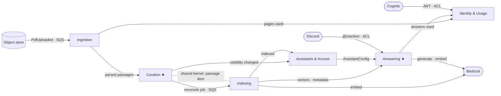

# RAGcat 領域設計（DDD）

API 細節見 `api-design.md`。這份文件定義 bounded context、aggregate 和它們之間的關係，作為程式結構的依據。

## 1. Bounded contexts

| Context | 類型 | 負責 | 部署位置 |
|---|---|---|---|
| **Curation** | core | 文件與 passage 的審閱、編輯 | `api`（`ingest`、`embed` 也會呼叫它的 service） |
| **Answering** | core | 問題 → 附引用的回答 | `qa` |
| **Ingestion** | supporting | PDF 驗證、解析、render 頁面、切出初始 passages | `ingest` Lambda |
| **Indexing** | supporting | passages 和向量之間的 reconcile | `embed` Lambda |
| **Assistants & Access** | supporting | Assistant 設定、publish、API key、Discord channel 綁定 | `api`（`qa`、`discord-bot` 只讀） |
| **Identity & Usage** | generic | owner 身分、方案、用量與 quota | `api`、`qa`、`ingest` |

切分原則：
- **Core 是產品和一般 RAG 不同的地方**：人工審閱過的 passages，以及附原文位置的回答。測試和設計心力集中在這兩個。
- **Ingestion 和 Indexing 分開**：兩邊的用語不同（頁面、文字區塊、bbox 對上 hash、向量），觸發時機也不同（上傳時對上 owner 按下 embed 時）。
- **Context 不等於部署單位**：`api` 裡放了三個 context。部署單位依擴縮特性切（見架構圖），context 依用語和 invariant 切。

## 2. 通用語言

| 詞 | 意思 | 程式 / API 名稱 |
|---|---|---|
| Owner | 有帳號、管理 Assistant 的人 | `User`，id 為 Cognito `sub` |
| Customer | 沒有帳號、透過 Discord 或 API key 發問的人 | `Caller` |
| Assistant | 一組文件和設定，對外回答問題 | `ast_` |
| Document | 上傳的一份 PDF | `doc_` |
| Passage | 回答時引用的最小段落；UI 用這個詞 | API 和儲存層叫 chunk，`chk_` |
| Edit / Merge / Split / Add / Remove / Restore | owner 對 passages 的編輯操作 | `/chunks` 系列 endpoint |
| Embed | 讓編輯過的內容生效，內部做 reconcile | `POST /documents/{id}/embed` |
| Pending change | 還沒 embed 的 passage 變動 | `pending_changes` |
| Published | Customer 是否可以發問 | `published` |
| Content version | Assistant 內容的世代，每次 embed 後 +1 | `content_version` |
| Answer / Citation / Fallback | 回答、引用的 passage、找不到依據時給的聯絡方式 | `ask` 回應 |
| Channel | Customer 發問的入口（Discord channel、API key） | `ChannelBinding`、`ApiKey` |

## 3. Aggregates 與 invariants

### Curation

- **`Document`**（aggregate root），底下有 **`Passage`**（entity）和 **`OpLogEntry`**。
- Value objects：`PassageText`、`SourceSpan`（頁、段、boxes）、`Box`、`Origin`、`Warning`。
- Invariants：
  - status 依狀態機轉換；`parsing`、`deleting` 時不能編輯。
  - merge 只能合併相鄰且依序的 passages。
  - split 的各段接起來要等於原文。
  - `origin=added` 的 passage 不能 restore。
  - 每次變更 `edit_version + 1`；API 的 `If-Match` 就是這個 aggregate 的樂觀鎖。
  - 每次變更後重算 warnings（domain service `PassageLinter`）。
- 一致性邊界：一個 Document 就是一個 DynamoDB partition（`DOC#{did}`）。一次變更是一個 `TransactWriteItems`，並以 `META.edit_version` 作為條件。
- 編輯操作只改 `text`、`deleted`、順序；`embedded_hash` 不歸 Curation 管。

### Ingestion

- 沒有自己的 aggregate，是一條 stateless pipeline：`PdfValidator` → `PageRenderer` → `TextExtractor` → `Chunker`（初始 passages 和 warnings）。
- `TextExtractor`：
  - 用 `find_tables()` 偵測表格，整張表轉成 Markdown，當成一個區塊。
  - 依欄位決定閱讀順序：雙欄頁面先讀完左欄再讀右欄；表格正上方的短標題跟著表格走。
  - 合併被 PDF 拆成多個區塊的同一段文字，並去掉頁首、頁尾和頁碼。
  - 圖片：點陣圖（`get_image_info`）和向量圖表（`cluster_drawings`）裡，佔頁面 4% 以上的才算圖；每頁重複出現的 logo、表格的格線不算。圖內的文字（軸標籤、數值）和圖說（Figure 1…、圖 1…）歸給這張圖，不會變成獨立段落。
- `FigureDescriber`：
  - 把圖裁下來（最長邊 1200px），送 `VisionModel`（Bedrock Converse，預設 `google.gemma-3-12b-it`）。圖內文字和圖說作為提示，描述用同一種語言。
  - 回答 `DECORATIVE` 的圖會被丟掉。每份文件最多 40 張，同時處理 4 張。
  - 描述以 `[Figure] …` 開頭，前面接圖說，自成一個 passage。Review 畫面會提醒 owner 這段是 AI 寫的。
- `Chunker`：
  - 長度以 word-equivalent 計算：英文以單字計，中日韓文字每 1.5 字算 1；斷句也認 `。！？`。這個計算放在 `shared/text.py`，Curation 的 warnings 和 token 數也用同一套。
  - 表格不切，太大時依列切開，每段都重複表頭。
- 結果透過 Curation 的 `import_parsed(document_id, passages)` 寫入。進度和失敗也透過 Curation 回報（`report_progress`、`fail(code)`），Ingestion 不直接改 Document。

### Indexing

- 狀態：每個 passage 的 `embedded_hash`。實體上存在 passage item 上，但只有 Indexing 會寫。
- Shared kernel：`VectorSpec`（embedding provider/model/dimensions、contextual 開關、context generator model）和 `wanted_hashes`。一個向量代表「embedding space + 本文 + section + context generator」，section 是依文件順序最近的一個標題。Curation 用同一套規則算出哪些段落待 embed；model 切換時既有 passages 會標為 pending。
- Domain service：`plan_reconcile(passages, spec) → ReconcilePlan { puts, deletes, purges }`。這是純函式，不做 I/O，單元測試主要測這裡。規則見 `api-design.md` §5。
- Contextual retrieval：`context_prompt` 和 `embedding_input` 在 `indexing/domain.py`；產生的 `context` 由 Indexing 寫入 passage，跟 `embedded_hash` 一樣不歸 Curation 管。
- 預覽：`plan_preview` / `prepare_preview` 用 `plan_reconcile` 找出未發布的段落，算出上下文和向量，暫存在 cache（`pv:{chk_id}:{hash}`），不寫入向量庫。reconcile 先查同一個 key，所以 Publish 會重用預覽算好的向量。
- Ports：`EmbeddingPort`、`VectorIndexPort`。
- Model adapters：`Embedder.embed(texts)` 的 OpenAI、Bedrock、Fake 實作獨立於 `Llm.stream/complete` 的 Claude、Bedrock、Fake 實作；只在 composition root 選擇。Indexing 和 Answering 共用同一 embedding adapter；向量 metadata 的 `embedding_key` 是檢索 filter，不能比較其他 provider/model 的向量或舊的未標記向量。

### Answering

- Value objects：
  - `Question`：正規化後的文字和 hash。
  - `Answer`：text、answered、fallback。
  - `Citation`：n、passage、page、para、boxes、edited。
  - `Caller`：Owner、ApiKey 或 DiscordChannel。
- Domain services：
  - `Retriever`：套用 filter，取 topK。owner 預覽時剔除失效的線上向量，併入 Indexing 準備的預覽向量（`merge_preview`）。
  - `AnswerComposer`：組 prompt；把 `[n]` 轉成 citations，最多 3 個；沒有依據時回 fallback。
- 規則：
  - 只能根據檢索到的 passages 回答。
  - 未 published 時只有 owner 能問。
- Ports：`LlmPort`、`EmbeddingPort`、`VectorSearchPort`、`AnswerCache`、`AssistantConfigReader`。
- Query embedding cache 依 embedding space 隔離；answer cache 另外依 QA/context model namespace 隔離，避免改用另一個模型後重用舊答案。
- 沒有需要持久化的 aggregate（questions log 是 P2）。

### Assistants & Access

- **`Assistant`**：name、fallback_contact、published、content_version、excluded_document_ids。
  - 開啟 published 前至少要有一份 `ready` 的文件。這是跨 aggregate 的檢查，由 application service 讀 document 狀態判斷，可以接受最終一致。
  - `content_version` 只增不減。
- **`ApiKey`**：hash、assistant_id、revoked_at。
- **`ChannelBinding`**：一個 Discord channel 只能綁一個 Assistant。PK 用 channel id 加 conditional put 保證，衝突時回 `409 CHANNEL_IN_USE`。
- Read model **`AssistantConfig`**：published、content_version、excluded_document_ids。給 Answering 讀，cache key 為 `ast:{aid}`。

### Identity & Usage

- **`Owner`**：sub、email、name、plan。Cognito 是外部系統，`JwtVerifier` 是 anti-corruption layer，把 JWT 轉成 `OwnerId`。其他 context 只認 `OwnerId`。
- 登入：`CognitoPasswordAuth` adapter 呼叫 Cognito API（註冊、密碼登入、refresh、撤銷），`IdentityService.sign_in/sign_up` 用驗證過的 ID token 建立 owner 記錄。
- **`UsageMeter`**（每月一筆）：pages_read、answers。`QuotaPolicy` 依 plan 給上限，用 atomic counter 加條件寫入保證不超過上限。

## 4. Context map



| 關係 | 模式 | 傳遞方式 | 說明 |
|---|---|---|---|
| Ingestion → Curation | Customer–Supplier | in-process | Curation 是 supplier，定義 `import_parsed` 的格式；`ingest` Lambda 內直接呼叫 |
| Curation ↔ Indexing | Shared kernel + 非同步訊息 | passage item + SQS | 同一個 passage item：Curation 擁有 text、deleted、順序；Indexing 擁有 `embedded_hash` 和 tombstone 清除 |
| Indexing → Answering | Published language | S3 Vectors | 向量 key 和 metadata schema 就是兩邊的契約 |
| Indexing → Answering（預覽） | Customer–Supplier | in-process | owner 的 Test：`plan_preview` 給失效的 key 和預覽向量，格式同上 |
| Assistants & Access → Answering | Conformist | Valkey cache-aside + DynamoDB | Answering 直接用 `AssistantConfig` 的格式 |
| Curation、Indexing → Assistants & Access | Domain events | in-process | 見 §5 |
| Cognito → Identity | Anti-corruption layer | JWT | `JwtVerifier` |
| Discord → Answering | Anti-corruption layer | Gateway WS + HTTP | `discord-bot` 把 Discord 訊息轉成 `ask` |
| Model providers → Indexing、Answering | Anti-corruption layer | Provider adapters | `EmbeddingPort`、`LlmPort`；本機 Claude QA + OpenAI embedding，雲端 Bedrock，離線測試明確選 fake |

## 5. Domain events

只列真的需要跨 context 傳遞的事件。不另外做 event bus：跨 runtime 的用 SQS，同一個 process 內就直接呼叫對方的 service。

| Event | 發出 | 接收 | 傳遞 |
|---|---|---|---|
| `PdfUploaded` | S3 | Ingestion | S3 → EventBridge → SQS `parse` |
| `DocumentParsed` | Ingestion | Curation | in-process |
| `PagesConsumed` | Ingestion | Identity & Usage | in-process（atomic counter） |
| `ReconcileRequested` | Curation | Indexing | SQS `embed` |
| `DocumentIndexed` | Indexing | Assistants & Access | in-process（`content_version + 1`，刪 `ast:{aid}`） |
| `DocumentVisibilityChanged` | Curation | Assistants & Access | in-process（停用或刪除；同上） |
| `AssistantConfigChanged` | Assistants & Access | Answering | 刪 cache key `ast:{aid}` |
| `AnswerGiven` | Answering | Identity & Usage | in-process（atomic counter） |

## 6. 程式結構

原本規劃的 `api/`、`worker/`、`qa/` 改成一個 Python package 加上幾個薄的進入點：

```
backend/
  pyproject.toml
  Dockerfile             兩個 target：service（api、qa；python slim）、worker（ingest、embed；Lambda base image）
  src/ragcat/
    shared/              ids（ULID）、errors、config、kernel（content_hash、now_iso）
    identity/            domain.py · service.py · adapters.py
    assistants/          同上
    curation/            同上
    ingestion/           同上
    indexing/            同上
    answering/           同上
    infra/               每個 port 的 AWS adapter 與本機替代：dynamo、storage、queue、vectors、models、cache
    apps/
      container.py       composition root：依設定挑 adapter、組裝 services
      http.py            api 和 qa 共用的 HTTP 層（序列化只放這裡）
      api.py / qa.py     ECS 進入點：uvicorn ragcat.apps.api:app / ragcat.apps.qa:app
      worker.py          Lambda 進入點：ingest()、embed()；本機 `python -m ragcat.apps.worker` 消費 Redis queue
      dev.py             本機：api + qa + S3 上傳與 /pages 的替代；RAGCAT_QUEUE=local 時 worker 在背景 thread
  tests/                 domain 單元測試 + 對 DynamoDB Local 的整合測試
web/                     React + Vite + TypeScript
infra/                   （待做）Terraform
```

規則：
- `domain.py` 不 import boto3 或 FastAPI，只放 entity、value object、invariant 和 domain service。
- 跨 context 只能呼叫對方 `service.py` 的公開函式，不能直接讀寫對方的 domain 物件。需要的話可以用 import-linter 檢查。
- 每個 context 先固定三個檔案。檔案變大再拆，不預先建 repository、factory、unit of work 這些層。

## 7. DynamoDB（single table）

一個 aggregate 對應一個 partition，也就是一個 transaction 邊界。

| Aggregate / 資料 | PK | SK | GSI1PK / GSI1SK |
|---|---|---|---|
| Owner | `USER#{sub}` | `PROFILE` | — |
| UsageMeter | `USER#{sub}` | `USAGE#{yyyy-mm}` | — |
| Assistant | `AST#{aid}` | `META` | `OWNER#{sub}` / `AST#{aid}` |
| Document | `DOC#{did}` | `META` | `AST#{aid}` / `DOC#{did}` |
| Passage | `DOC#{did}` | `CHK#{cid}` | — |
| OpLogEntry | `DOC#{did}` | `OP#{ulid}` | — |
| ApiKey | `KEY#{sha256}` | `META` | `AST#{aid}` / `KEY#{kid}` |
| ChannelBinding | `CHAN#discord#{channel_id}` | `META` | `AST#{aid}` / `CHAN#{channel_id}` |

- Passage 的順序存在 `order_key` 屬性（fractional index），讀出來後在程式裡排序；一份文件最多幾百筆。
- 「我的 Assistants」和「Assistant 的文件」用 GSI1 查。
